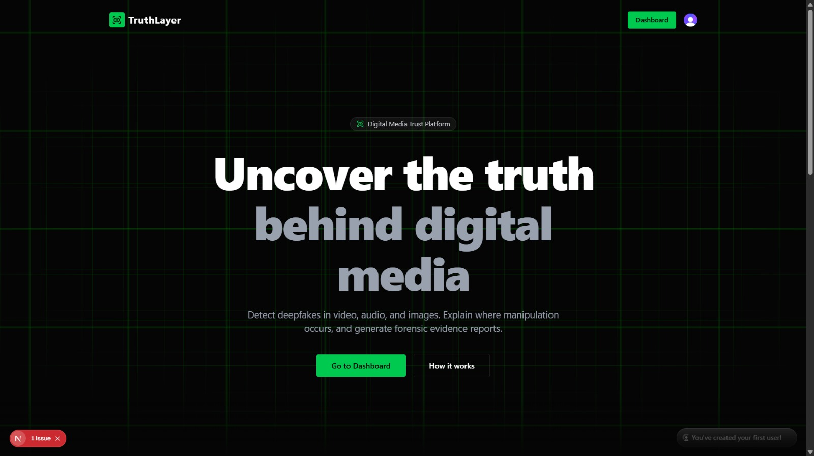
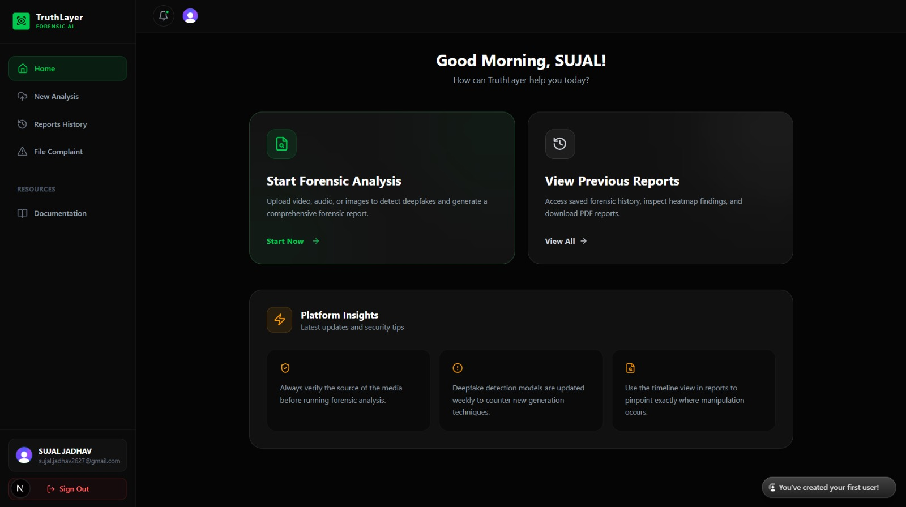
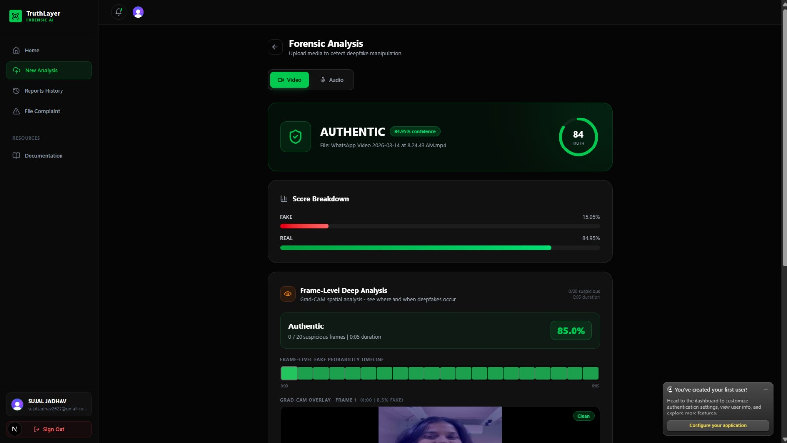
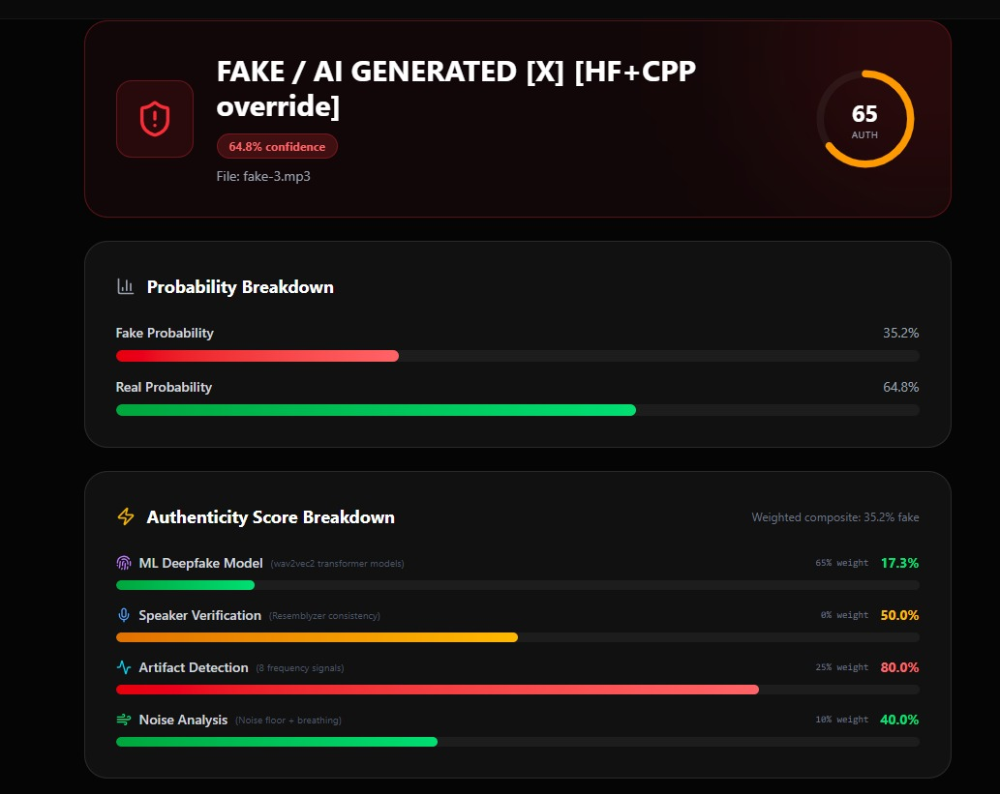
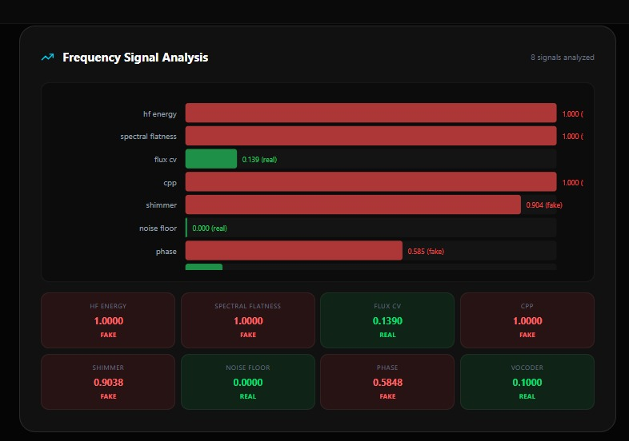

# Video+Audio Manipulation Analyzer — Docs & Progress

Purpose:
- Single-developer, AI-assisted platform for detecting manipulated media with explainability and a human-in-the-loop.

Docs added:
- docs/system_architecture.md
- docs/ai_architecture.md
- docs/skills.md
- docs/subagents.md
- PROGRESS.md

Next steps:
- Create hard-case validation set, implement 3-state API, finish audio pipeline, scaffold review UI.

Branching & contributions:
- Branch naming: feature/*, fix/*, hotfix/*
# TruthLens

A forensic-grade deepfake detection platform that catches manipulated video and audio — and tells you exactly which tool made it.

Built for HackVerse Cybersecurity Challenge by **ByteDevs**.



---

## The Problem

Deepfakes are everywhere now. ElevenLabs can clone your voice in 30 seconds. Face-swap videos take minutes. And none of the existing detectors actually tell you *what tool was used* or *why* they think something is fake. They just spit out a number.

TruthLens is different. When you upload a suspicious file, you get:

- A clear FAKE/REAL verdict with confidence percentage
- Frame-by-frame Grad-CAM heatmaps showing WHERE manipulation appears (video)
- 8 independent frequency-domain signals explaining WHY it's fake (audio)
- Tool identification — was this made with ElevenLabs, RVC, XTTS, or OpenAI TTS?
- A cryptographically signed forensic certificate you can actually use as evidence
- An AI debate panel where a Prosecutor and Defender argue over the evidence

---

## Screenshots

| Landing Page | Dashboard |
|:---:|:---:|
|  |  |

| Video Analysis | Audio Analysis |
|:---:|:---:|
|  |  |

| Grad-CAM Heatmap |
|:---:|
|  |

---

## How It Works

### Video Detection

1. You upload an MP4/AVI/MOV file
2. The backend extracts 20 frames using OpenCV
3. Each frame passes through a **ResNeXt-50 + LSTM** model (87% accuracy, trained on FaceForensics++)
4. Model outputs a FAKE/REAL classification with confidence
5. **Grad-CAM** generates heatmaps for each frame — red zones = where the model sees manipulation (usually around the jawline, eyes, and hairline for face-swaps)
6. The timeline view lets you scrub through and see exactly which frames are suspicious

### Audio Detection (8-Step Pipeline)

This is where it gets interesting. We don't just throw audio at a neural network and hope for the best. We run an 8-step forensic pipeline:

| Step | What It Does | How |
|------|-------------|-----|
| 1. Preprocessing | Normalize audio | FFmpeg converts to 16kHz mono WAV |
| 2. Voice Activity | Find where speech is | WebRTC VAD with 30ms frames |
| 3. MFCC Features | Extract voice characteristics | 13 MFCCs + deltas = 39 features |
| 4. Speaker Verification | Check voice consistency | Resemblyzer embeddings, cosine similarity |
| 5. ML Detection | Neural network classification | wav2vec2-large-xlsr + Wav2Vec2 ensemble |
| 6. Artifact Analysis | 8 frequency signals | HF energy, spectral flatness, shimmer, noise floor, phase, CPP, flux, vocoder |
| 7. Breathing Detection | Look for human breathing | Spectral analysis of non-speech gaps |
| 8. Authenticity Score | Final weighted verdict | 55% ML + 25% artifacts + 10% speaker + 10% noise |

### The 8 Frequency Signals (This is what catches ElevenLabs)

These are the real workhorses. Each one measures something specific that AI voices get wrong:

| Signal | What It Measures | Why AI Fails |
|--------|-----------------|--------------|
| **HF Energy** | Energy above 4kHz | AI produces unnaturally full-bandwidth audio. Real mics cut off high frequencies. 18x difference between fake and real. |
| **Spectral Flatness** | How "flat" the frequency spectrum is | AI audio has uniform energy distribution. Real speech has harmonic peaks. 2.9x difference. |
| **Flux CV** | How regular spectral changes are | AI has smooth, predictable spectral transitions. Real speech is bursty. |
| **CPP** | Cepstral Peak Prominence | AI has overly periodic voice source. Too perfect pitch tracking. |
| **Shimmer** | Amplitude variation in voiced segments | AI has no natural tremor. Real voices wobble slightly. |
| **Noise Floor** | How clean the silence is | AI silence is digital zero. Real silence has room noise, mic hiss, breathing. |
| **Phase Coherence** | Phase structure regularity | AI has structured phase from synthesis algorithms. Real phase is more random. |
| **Vocoder Fingerprint** | Cepstral periodicity | Some TTS tools leave periodic comb patterns in the cepstrum. |

### Tool Identification

After detecting a fake, we don't just say "it's fake" — we tell you what made it:

- **ElevenLabs** — Indicator-based detection (9 binary indicators, needs 6+ for high confidence)
- **RVC** — Detected via bursty flux patterns and phase anomalies
- **XTTS/Coqui** — Caught by diffusion smearing in spectral transitions
- **OpenAI TTS** — Identified through extremely flat spectrum and clean noise floor
- **Generic TTS** — Vocoder fingerprint + high CPP

### AI Debate Panel

After analysis, an AI Prosecutor and Defender argue over the evidence in 3 rounds using a local Ollama LLM (llama3). The Prosecutor makes the case for fake, the Defender argues for authentic, and a Judge delivers the final verdict. This gives you a human-readable explanation of the evidence.

### Forensic Reports & Certificates

Every analysis can generate:
- A **PDF forensic report** with all scores, signals, and heatmap data
- A **digital certificate** with SHA-256 payload hash and Ed25519 signature
- The certificate is cryptographically verifiable — tamper with the report and the signature breaks
- Reports are shareable via unique links
- You can file complaints directly from a report

---

## Tech Stack

| Layer | What We Used | Why |
|-------|-------------|-----|
| Frontend | Next.js 15, React 19, TypeScript | App Router, Server Components, fast iteration |
| Styling | Tailwind CSS 4, Motion (framer-motion) | Dark theme, smooth animations |
| Auth | Clerk | Protected dashboard routes, user management |
| Backend | FastAPI, Uvicorn | Async Python, auto-docs at /docs |
| Video ML | PyTorch, ResNeXt-50 + LSTM, Grad-CAM | Frame-level deepfake detection with spatial heatmaps |
| Audio ML | wav2vec2-large-xlsr, Wav2Vec2 v2 | HuggingFace transformer models for audio classification |
| Audio DSP | librosa, scipy, numpy | Frequency signal analysis, MFCC, spectral features |
| VAD | WebRTC VAD | Voice activity detection at 30ms resolution |
| Speaker | Resemblyzer | d-vector speaker embeddings for consistency checks |
| Reports | fpdf2, qrcode, cryptography | PDF generation, QR codes, Ed25519 signatures |
| AI Debate | Ollama (llama3) | Local LLM for adversarial reasoning |
| Model Hub | HuggingFace Hub | Auto-download model weights on first run |

---

## Project Structure

```
truthlens/
|
+-- backend/
|   +-- main.py                          # FastAPI server, endpoints, model loading
|   +-- model/
|   |   +-- detector.py                  # ResNeXt-50 + LSTM video model
|   |   +-- processor.py                 # Video frame extraction (OpenCV)
|   |   +-- gradcam.py                   # Grad-CAM heatmap generation
|   +-- audio/
|   |   +-- audio_deepfake_detector.py   # Full 8-step audio pipeline (~1500 lines)
|   +-- ai_debate/
|   |   +-- debate_engine.py             # 3-round Prosecutor vs Defender
|   |   +-- ollama_client.py             # Ollama HTTP client
|   |   +-- prompts.py                   # System prompts for each role
|   +-- reports/
|   |   +-- generator.py                 # JSON/PDF report generation
|   |   +-- certificate.py               # Ed25519 signing + verification
|   |   +-- routes.py                    # Report CRUD, PDF download, sharing
|   +-- complaints/
|   |   +-- routes.py                    # Complaint filing API
|   +-- requirements.txt
|   +-- .env.example
|
+-- frontend/
|   +-- app/
|   |   +-- page.tsx                     # Landing page (Hero + HowItWorks)
|   |   +-- layout.tsx                   # Root layout with Clerk provider
|   |   +-- dashboard/
|   |   |   +-- page.tsx                 # Dashboard home
|   |   |   +-- analyze/page.tsx         # Upload + Analysis page (video & audio)
|   |   |   +-- history/page.tsx         # Report history browser
|   |   |   +-- complaint/page.tsx       # Complaint assistant
|   |   +-- api/
|   |       +-- analyze/route.ts         # Proxy to backend /analyze (video)
|   |       +-- analyze-audio/route.ts   # Proxy to backend /analyze-audio
|   |       +-- heatmap/route.ts         # Proxy to backend Grad-CAM
|   |       +-- debate/route.ts          # Proxy to backend debate engine
|   |       +-- report/                  # Report generate, history, share, PDF
|   |       +-- complaint/               # Complaint CRUD
|   +-- components/
|   |   +-- HeatmapTimeline.tsx          # Frame-by-frame heatmap scrubber
|   |   +-- ForensicReport.tsx           # Certificate + PDF generation UI
|   |   +-- DebatePanel.tsx              # AI Prosecutor vs Defender UI
|   |   +-- Sidebar.tsx                  # Dashboard navigation
|   |   +-- Hero.tsx                     # Landing page hero section
|   |   +-- HowItWorks.tsx              # Landing page 3-step explainer
|   +-- middleware.ts                    # Clerk auth (protects /dashboard/*)
|   +-- package.json
|   +-- .env.example
|
+-- docs/images/                         # Screenshots (add before pushing)
```

---

## Setup

### What You Need

- **Python 3.10+** (we used 3.12)
- **Node.js 18+** (we used 20)
- **FFmpeg** on your PATH — the audio pipeline needs it for format conversion
  - Windows: `winget install Gyan.FFmpeg` (the backend auto-detects winget installs)
  - Mac: `brew install ffmpeg`
  - Linux: `sudo apt install ffmpeg`
- **Ollama** running locally (optional, for AI debate panel)
  - Install from [ollama.ai](https://ollama.ai)
  - Pull the model: `ollama pull llama3`
- **A HuggingFace account** — you need a token to download the video model weights

### Backend Setup

```bash
cd backend

# Create virtual environment
python -m venv venv

# Activate it
# Windows:
venv\Scripts\activate
# Mac/Linux:
source venv/bin/activate

# Install dependencies
pip install -r requirements.txt

# Optional: Install WebRTC VAD and Resemblyzer for full audio pipeline
pip install webrtcvad
pip install resemblyzer

# Set up environment variables
cp .env.example .env
# Edit .env and add your HF_TOKEN from https://huggingface.co/settings/tokens
```

**Start the backend:**
```bash
python main.py
```

The server starts on `http://localhost:8001`. On first run, it downloads:
- Video model weights (~226 MB) from HuggingFace
- wav2vec2-large-xlsr audio model (~1.2 GB) from HuggingFace
- Wav2Vec2 v2 audio model (~380 MB) from HuggingFace

These are cached in `backend/model_cache/` and `~/.cache/huggingface/`.

### Frontend Setup

```bash
cd frontend

# Install dependencies
npm install

# Set up environment variables
cp .env.example .env.local
# The backend runs on port 8001 — the API routes handle proxying
```

**Start the frontend:**
```bash
npm run dev
```

Open `http://localhost:3000`. You'll see the landing page. Sign in with Clerk to access the dashboard.

---

## Usage

### Analyzing Video

1. Go to **Dashboard > Analyze**
2. Switch to the **Video** tab
3. Upload an MP4, AVI, or MOV file
4. Wait for the model to process (takes 5-15 seconds depending on length)
5. You get: verdict (REAL/FAKE), confidence %, truth score
6. Click **Run Heatmap** to see frame-by-frame Grad-CAM analysis
7. Red zones on the heatmap = where the model sees manipulation

### Analyzing Audio

1. Go to **Dashboard > Analyze**
2. Switch to the **Audio** tab
3. Upload an MP3, WAV, or FLAC file
4. The 8-step pipeline runs automatically (takes 10-30 seconds)
5. You get:
   - Verdict with fake/real probability bars
   - Authenticity breakdown (ML model, speaker verification, artifact detection, noise analysis)
   - All 8 frequency signal scores with FAKE/REAL votes
   - Source tool identification (ElevenLabs, RVC, etc.)
   - MFCC regularity, speaker consistency, breathing detection results
   - ML model chunk-by-chunk timeline

### Generating Reports

1. After any analysis, scroll down to the **Forensic Report** section
2. Click **Generate Certificate** to create a signed forensic certificate
3. Click **Download PDF** for a full PDF report
4. Use **Share** to generate a public link
5. Reports are saved and accessible from **Dashboard > History**

### Filing Complaints

1. From a generated report, click **Use This Report For Complaint**
2. Fill in the recipient, subject, and narrative
3. The complaint is saved with a reference to the forensic report

---

## API Endpoints

The backend exposes these endpoints (full docs at `http://localhost:8001/docs`):

| Method | Endpoint | What It Does |
|--------|----------|-------------|
| GET | `/health` | Server health + model load status |
| POST | `/analyze` | Upload video, get deepfake verdict |
| POST | `/analyze-audio` | Upload audio, get full 8-step analysis |
| POST | `/api/heatmap` | Generate Grad-CAM heatmaps for video |
| POST | `/api/debate` | Run AI debate on analysis results |
| POST | `/api/report/generate` | Generate forensic JSON report |
| GET | `/api/report/history` | List all saved reports |
| GET | `/api/report/{id}` | Get specific report |
| GET | `/api/report/{id}/pdf` | Download PDF report |
| POST | `/api/report/share` | Generate shareable link |
| POST | `/api/complaint` | File a complaint with report reference |

---

## Environment Variables

### Backend (`backend/.env`)

| Variable | Required | Description |
|----------|----------|-------------|
| `HF_TOKEN` | Yes | HuggingFace API token for downloading model weights |
| `MODEL_ID` | No | HuggingFace model repo (default: `tayyabimam/Deepfake`) |
| `OLLAMA_BASE_URL` | No | Ollama server URL (default: `http://localhost:11434`) |
| `OLLAMA_MODEL` | No | LLM model for debate (default: `llama3`) |

### Frontend (`frontend/.env.local`)

| Variable | Required | Description |
|----------|----------|-------------|
| `NEXT_PUBLIC_CLERK_PUBLISHABLE_KEY` | Yes | Clerk publishable key |
| `CLERK_SECRET_KEY` | Yes | Clerk secret key |

---

## What We Learned

- Neural networks alone aren't great at catching modern voice clones. ElevenLabs audio passes wav2vec2 about 40% of the time. The frequency signals are what actually catch it.
- HF energy ratio is the single strongest signal for ElevenLabs detection — 18x difference between fake and real audio. AI synthesis produces full-bandwidth audio while real recordings have mic/codec rolloff.
- Grad-CAM heatmaps are genuinely useful for explaining WHY a video is fake, not just THAT it's fake. Judges and non-technical people can actually understand what a heatmap is showing.
- WebRTC VAD is way better than energy-based voice detection. Worth the extra dependency.
- Ed25519 signatures are fast and the certificates are tiny. Good fit for forensic reports.

---

## Team

**ByteDevs** — HackVerse Cybersecurity Challenge

---

## License

This project was built for a hackathon. Use it for learning, research, and security testing.
